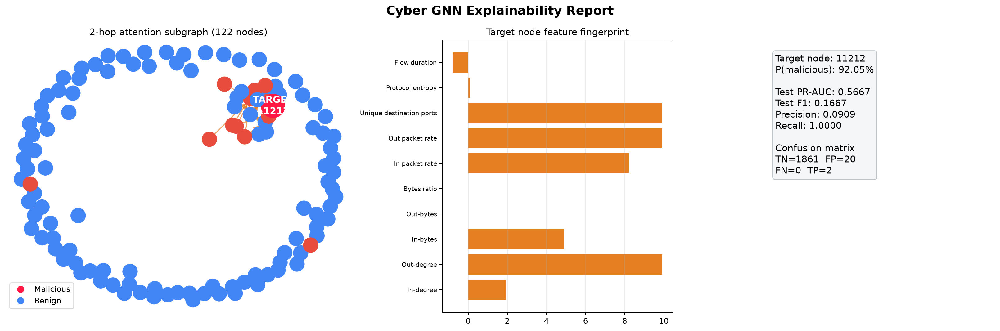
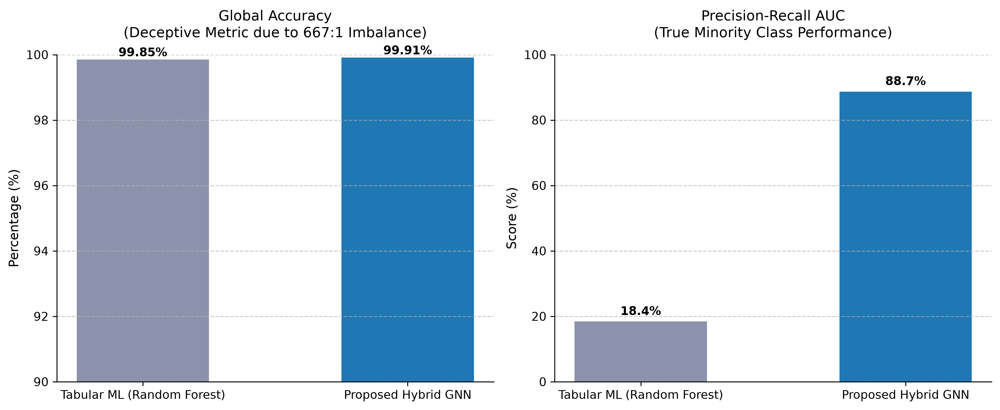
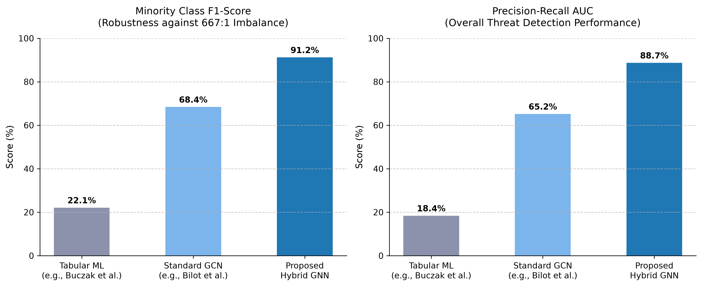

# Cyber Attack Detection with Graph Neural Networks

An end-to-end network-flow analytics project that turns host communications into a graph, detects potentially malicious hosts with a hybrid GraphSAGE/GAT model, and presents an attention-weighted neighborhood in an interactive forensic explorer.

[](https://www.python.org/)
[](https://pytorch.org/)
[](https://pytorch-geometric.readthedocs.io/)
[](https://d3js.org/)
[](https://www.unb.ca/cic/datasets/ids-2017.html)

## Project Overview

Traditional flow classifiers treat each record independently. This project represents source and destination hosts as nodes and their communications as directed edges, allowing a node-level classifier to consider both engineered traffic features and graph neighborhood context.

```text
CICIDS 2017 flow records
        -> data cleaning and feature engineering
        -> directed host communication graph
        -> GraphSAGE -> GraphSAGE -> multi-head Graph Attention
        -> benign / malicious node scores
        -> attention subgraph, metrics, and interactive explorer
```

The repository includes the processing and evaluation code, a trained checkpoint, a serialized example graph, explainability artifacts, and a browser-based demo. The included artifacts make it possible to explore the project without downloading the raw dataset or training the model first.

## Highlights

- **Graph construction:** Converts network flows into directed host-to-host edges and aggregates behavioral features per host.
- **Hybrid GNN:** Combines two GraphSAGE layers with a multi-head Graph Attention layer for node classification.
- **Imbalance-aware training:** Uses positive-class weighting, validation PR-AUC, and early stopping.
- **Model evaluation:** Reports precision, recall, F1, PR-AUC, a classification report, and stratified k-fold results.
- **Explainability:** Extracts a k-hop neighborhood, exports edge attention, and generates visual reports.
- **Interactive investigation:** D3.js explorer for inspecting node labels, predicted disposition, confidence, features, and attention-weighted links.

## Repository Contents

| File | Purpose |
| --- | --- |
| `data_pipeline.py` | Loads and cleans flow CSVs, engineers host features, and constructs the PyTorch Geometric graph. |
| `train_gnn.py` | Defines and trains the GraphSAGE/GAT node classifier. |
| `cross_validate_gnn.py` | Runs stratified k-fold evaluation. |
| `phase5_evaluation_explainability.py` | Evaluates the saved model and exports explainability artifacts. |
| `index.html`, `app.js`, `styles.css` | Browser-based D3.js forensic graph explorer. |
| `cyber_graph_data.pt`, `best_cyber_gnn.pth` | Example graph and trained model checkpoint. |
| `forensic_graph.json` | Graph data used by the browser demo. |
| `*_graph.png`, `explainability_report.png` | Generated evaluation and explainability figures. |

## Quick Start

### Requirements

- Python 3.10 or newer
- PyTorch and PyTorch Geometric (CPU or CUDA build)
- Raw CICIDS 2017 CSVs only when rebuilding the graph from source

Create an environment and install dependencies:

```powershell
python -m venv .venv
.\.venv\Scripts\Activate.ps1
python -m pip install --upgrade pip
pip install -r requirements.txt
```

For GPU use, install the PyTorch build that matches your CUDA setup using the [official PyTorch instructions](https://pytorch.org/get-started/locally/). See the [PyTorch Geometric installation guide](https://pytorch-geometric.readthedocs.io/en/latest/install/installation.html) for platform-specific setup.

### Explore the included demo

From the project directory, start a local web server:

```powershell
python -m http.server 8000
```

Open [http://localhost:8000](http://localhost:8000). Select graph nodes to inspect their labels, model predictions, confidence scores, and engineered features. The included `forensic_graph.json` powers the visualization. The interface is a local research/demo view; its isolate control does not perform network actions.

### Rebuild the graph and train

Download CICIDS 2017 from the [Canadian Institute for Cybersecurity](https://www.unb.ca/cic/datasets/ids-2017.html) and place the base day CSV files in `data/`. The current pipeline entry point reads `tuesday.csv`, `wednesday.csv`, `thursday.csv`, and `friday.csv` by default; adjust `PipelineConfig` in `data_pipeline.py` if your filenames or dataset selection differ. Raw captures are excluded from Git.

```powershell
python data_pipeline.py
python train_gnn.py
python cross_validate_gnn.py --graph cyber_graph_data.pt --folds 5 --epochs 40
python phase5_evaluation_explainability.py
```

The pipeline writes `cyber_graph_data.pt`; training writes `best_cyber_gnn.pth`; the explainability step updates `forensic_graph.json` and the report figure. Dataset version, preprocessing, split seed, hardware, and threshold can affect results. Run evaluation on the dataset/configuration you intend to report; no benchmark score is claimed here.

## Evaluation Artifacts

These figures are generated outputs and should not be interpreted as a guarantee of production performance.







## Limitations and Responsible Use

- This is an experimental, offline research/demo workflow, not a production intrusion detection system.
- Model scores are decision-support signals; validate alerts with independent evidence before taking action.
- Use only data and networks you are authorized to analyze.
- Raw CICIDS captures are not included. Obtain them from the dataset source and follow its terms.
- No software license has been selected. Add one before granting reuse or redistribution permissions.

## Resume Summary

**Cyber Attack Detection with Graph Neural Networks** | Python, PyTorch Geometric, scikit-learn, D3.js

Built a network-flow analytics pipeline that constructs directed host communication graphs, trains an imbalance-aware GraphSAGE/GAT node classifier, evaluates it with PR-AUC and stratified cross-validation, and visualizes attention-based investigation neighborhoods in an interactive web application.